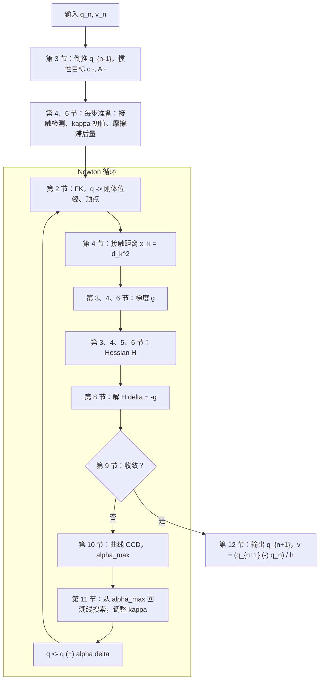

# 一个时间步的全貌

这篇笔记把完整 RC-IPC 的一个时间步从头走到尾。每一步都按同样的顺序写：

1. **要解决什么问题**
2. **物理想法**
3. **推导**：一步一步，不跳步
4. **怎么算**：输入、计算顺序、输出，对应代码里的哪个函数
5. **检验**：一个能手算的小例子，或者一个必须成立的性质

阶段 1–3 已经做过的部分，在对应笔记（[01](01_ipc1d.md)、[02](02_kinematics.md)、[03](03_inertia.md)）里有更多细节。
阶段 4–9 还没做，这里先把推导主线写清楚，实现细节留到各阶段的笔记。

书页码指《关节体 IPC 全书》（印刷页码和 PDF 页码相同）。书上对一个时间步的总结见图 48（第 218 页）和 §11.8（第 251–253 页）。

记号：
- $q$：关节坐标，长度 nq。
- $\delta$：切空间里的方向，长度 nv。代码里的 Newton 方向 `p` 就是它。
- $q \oplus s\delta$：从 $q$ 沿 $\delta$ 走 $s$ 倍（`integrate`）。
- $q_1 \ominus q_0$：两个位置之差（`differentiate`）。

---

## 0. 总览

整件事分三层：

1. **外层：时间步。** 准备目标，调用 Newton，最后算速度。
2. **中层：Newton 求解器。** 方向、CCD、线搜索、收敛判断。它和坐标无关，阶段 1 就已经齐了。
3. **内层：能量项。** 惯性、障碍、摩擦。每一项都用同一个套路：

$$
q \xrightarrow{\ \text{FK}\ } \text{世界坐标里的量} \xrightarrow{\ \text{笛卡尔公式}\ } E \xrightarrow{\ \text{Jacobian 投影}\ } g = J^\top \nabla_x E,\quad H \approx J^\top (\nabla_x^2 E)\, J
$$

---

## 1. 一步 = 最小化一个能量（阶段 1，书 §3.1、§7.4）

### 要解决什么问题

已知这一步开始时的位置 $x^n$ 和速度 $v^n$，求一个时间步 $h$ 之后的位置 $x^{n+1}$。

难点在于接触力。它在接触附近非常“硬”：距离从 1 mm 变到 0.1 mm，力可以涨上千倍。

- **显式 Euler**（用这一步开始时的力）：$h$ 稍大，就会一步冲过去穿透，或者被弹飞。
- **隐式 Euler**（用这一步结束时的力）：稳定。但力依赖未知的 $x^{n+1}$，得到的是一个非线性方程，需要一个可靠的解法。

### 物理想法

如果所有的力都来自势能，隐式 Euler 的方程恰好是某个能量的“导数为 0”。于是：

- 解方程变成了找最小值；
- 找最小值可以用“能量有没有下降”来判断每一步走得对不对。

### 推导

**第 1 步：写出隐式 Euler。** 质量矩阵 $M$，重力加速度 $g$，其他力 $F$：

$$
v^{n+1} = v^n + h\,\big(g + M^{-1} F(x^{n+1})\big)
$$

$$
x^{n+1} = x^n + h\, v^{n+1}
$$

**第 2 步：消去 $v^{n+1}$。** 把第一式代入第二式：

$$
x^{n+1} = x^n + h v^n + h^2 g + h^2 M^{-1} F(x^{n+1})
$$

把不含未知力的部分记为 $\tilde x$（预测位置）：

$$
\tilde x = x^n + h v^n + h^2 g
$$

$$
x^{n+1} - \tilde x = h^2 M^{-1} F(x^{n+1})
$$

两边左乘 $M/h^2$：

$$
\frac{1}{h^2} M\,(x^{n+1} - \tilde x) - F(x^{n+1}) = 0
$$

**第 3 步：力写成势能的负梯度。** 设 $F = -\nabla\Psi$，方程变成

$$
\frac{1}{h^2} M\,(x - \tilde x) + \nabla\Psi(x) = 0
$$

**第 4 步：找一个梯度恰好是左边的函数。** $\tfrac{1}{2h^2}(x-\tilde x)^\top M (x-\tilde x)$ 的梯度是 $\tfrac{1}{h^2} M (x - \tilde x)$，所以

$$
E(x) = \frac{1}{2h^2}\,(x - \tilde x)^\top M\, (x - \tilde x) + \Psi(x), \qquad \nabla E(x) = 0 \iff \text{隐式 Euler 方程}
$$

**第 5 步：确认是极小点。** Hessian 是

$$
\nabla^2 E = \frac{M}{h^2} + \nabla^2\Psi
$$

$h = 0.002$ 时 $1/h^2 = 2.5\times10^5$，第一项通常足以压住 $\nabla^2\Psi$ 里的负特征值，所以 Hessian 正定，驻点就是极小点。

### 怎么算

$$
x^{n+1} = \arg\min_x E(x)
$$

用 Newton 法加线搜索（第 8–11 节）。阶段 1 的 `ipc1d::step` 就是一维的情形：$E = \frac{m}{2h^2}(x-\tilde x)^2 + \kappa b(x)$。

### 检验

- **没有其他力（$\Psi = 0$）：** 极小点就是 $x = \tilde x = x^n + hv^n + h^2 g$。它和自由落体的隐式 Euler 结果一致，测试 `JointStep.FreeFallIsOneNewtonStep` 检查的就是这一点。
- **单位约定：** IPC 原论文写 $\tfrac12\lVert x - \tilde x\rVert_M^2 + h^2\Psi$。本仓库和书一样，把整体除以 $h^2$，这样每一项都是焦耳（书第 151 页）。

---

## 2. 关节坐标、FK 和 Jacobian（阶段 2，书 §1.3–1.4、§7.2–7.3）

### 要解决什么问题

机械臂、人体这类系统由关节连接。如果直接用每个顶点的世界坐标当未知量：

- 关节要靠额外的约束或罚函数来维持，只能近似满足，会“脱臼”；
- 刚体要靠很硬的弹簧维持形状，会变形；
- 未知量的数量是顶点数的 3 倍，非常多。

### 物理想法

直接用关节坐标 $q$ 当未知量。任何 $q$ 都对应一个关节完好、刚体不变形的构型，所以约束永远精确满足。代价是：

- 顶点位置变成了 $q$ 的非线性函数（FK）；
- 所有导数都要经过 Jacobian。

### 推导

**第 1 步：FK。** 刚体 $b$ 的位姿是 $(x_b, R_b)$，顶点在刚体坐标系里的坐标 $\bar X_v$ 是常数：

$$
X_v(q) = x_b(q) + R_b(q)\, \bar X_v
$$

$(x_b, R_b)$ 从根往下递推：

- 父刚体的位姿，乘上固定偏移，得到这个刚体在关节未动时的位姿；
- 再乘上自己关节的转动或平移。

**第 2 步：一个转动关节转一点，点怎么动。** 设关节轴是单位向量 $a$，过锚点 $o$。点 $X$ 绕它转角度 $s$：

$$
X(s) = o + \mathrm{Rot}(a, s)\,(X - o)
$$

在 $s = 0$ 处求导，转动的导数是叉乘 $a\times$：

$$
\frac{dX}{ds}\Big|_{s=0} = a \times (X - o)
$$

**第 3 步：一个平移关节动一点。** $X(s) = X + s\,a$，导数是 $a$。

**第 4 步：整条链。** 关节 $d$ 动的时候，它下游所有刚体一起刚性地动，上游和别的分支不动。所以

$$
J_d(X) = \frac{\partial X}{\partial \delta_d} = \begin{cases} a_d \times (X - o_d), & d \text{ 是 } X \text{ 所在刚体到根的链上的转动自由度} \\ a_d, & d \text{ 是链上的平移自由度} \\ 0, & d \text{ 不在链上} \end{cases}
$$

球关节和自由关节的转动部分，每个自由度的轴取 $R\,e_k$（转动之后的 body 系坐标轴），和 `integrate` 的右乘约定一致。

**第 5 步：为什么“走一步”不能直接相加。** 四元数必须保持单位长度，直接相加会离开单位球。所以转动部分用指数映射：

$$
r \oplus s\delta = r \otimes \exp(s\,\delta_{\text{rot}})
$$

$\exp$ 把一个三维的转动向量变成一个单位四元数。`differentiate` 用 $\log(r_0^{-1} r_1)$ 做反向的事。

**第 6 步：在 $q$ 里求极小，约束力去哪了。** 能量写成 $E(x(q))$。由链式法则，

$$
\nabla_q E = J^\top \nabla_x E
$$

在 $q$ 上的极小点满足 $J^\top \nabla_x E = 0$。这时 $\nabla_x E$ 本身并不为 0，差出来的部分就是关节的约束力。但它在每一个允许的运动方向（$J$ 的每一列）上的投影都是 0，也就是约束力不做功（d'Alembert 原理）。所以 RC-IPC 从来不需要求约束力。

### 怎么算

| 要什么 | 函数 | 输出 |
|---|---|---|
| 每个刚体的位姿 | `forward_kinematics(model, q)` | `Frames`：`xpos`、`xquat`，以及每个自由度的 `dof_axis`、`dof_anchor` |
| 刚体上一个点的世界坐标 | `world_point(frames, b, local)` | $x_b + R_b\,\bar X$ |
| 点的 Jacobian | `point_jacobian(model, frames, b, X)` | 3×nv，按第 4 步逐列填 |
| 角速度 Jacobian | `angular_jacobian(model, frames, b)` | 3×nv，转动自由度的列是 $a_d$ |
| 走一步，求差 | `integrate`、`differentiate` | — |

### 检验

- FK 和 Jacobian 都和 MuJoCo 逐项比对：`mj_kinematics`、`mj_jac`（`Fk.MatchesMujocoAtRandomPoses`、`Jacobian.MatchesMujoco`）。
- Jacobian 和 FK 的有限差分一致：$J\delta \approx \big(X(q \oplus \epsilon\delta) - X(q)\big)/\epsilon$（`Jacobian.MatchesFiniteDifference`）。

---

## 3. 惯性项（阶段 3，书 §7.5，第 152–155 页）

### 要解决什么问题

第 1 节的惯性项 $\tfrac{1}{2h^2}\lVert x - \tilde x\rVert_M^2$ 是按质点写的。现在未知量是 $q$，要把它改写成 $q$ 的函数，并且：

- 刚体的转动惯量要正确地体现出来；
- 旋转的刚体不能凭空获得能量。

### 物理想法

把刚体看成无数个质点，每个质点各自做隐式 Euler。它们被刚性和关节约束住，所以不能各自到达目标；Newton 在 $q$ 上找“整体离目标最近”的构型。

### 推导

**第 1 步：每个质点的目标。** 由第 1 节，$\tilde x_p = x_p^n + h v_p^n + gh^2$。上一步也是隐式 Euler，有 $x_p^n = x_p^{n-1} + h v_p^n$，即 $h v_p^n = x_p^n - x_p^{n-1}$。代入：

$$
\tilde x_p = 2x_p^n - x_p^{n-1} + gh^2
$$

**第 2 步：用刚性把质点合并。** 同一个刚体上，$x_p = c + R X_p$。$X_p$ 以质心为原点，是常数。对第 $n$ 步和第 $n-1$ 步各写一次：

$$
x_p^n = c^n + R^n X_p
$$

$$
x_p^{n-1} = c^{n-1} + R^{n-1} X_p
$$

代入第 1 步，展开：

$$
\tilde x_p = 2c^n + 2R^n X_p - c^{n-1} - R^{n-1} X_p + gh^2
$$

把不含 $X_p$ 的项和含 $X_p$ 的项分开：

$$
\tilde x_p = (2c^n - c^{n-1} + gh^2) + (2R^n - R^{n-1})\, X_p
$$

记

$$
\tilde c = 2c^n - c^{n-1} + gh^2, \qquad \tilde A = 2R^n - R^{n-1}
$$

于是 $\tilde x_p = \tilde c + \tilde A X_p$：整个刚体的目标只要两个量。

**第 3 步：对质点求和，得到能量。** 记 $D = R - \tilde A$，一个质点的残差是

$$
x_p - \tilde x_p = (c - \tilde c) + D X_p
$$

平方后对质点加权求和：

$$
\sum_p m_p \lvert x_p - \tilde x_p\rvert^2 = \sum_p m_p \lvert c - \tilde c\rvert^2 + 2 (c - \tilde c)\cdot D \sum_p m_p X_p + \sum_p m_p\, X_p^\top D^\top D X_p
$$

逐项看：

- **第一项：** 等于 $m\lvert c - \tilde c\rvert^2$，其中 $m = \sum_p m_p$。
- **第二项：** 原点取在质心，所以 $\sum_p m_p X_p = 0$，这一项消失。
- **第三项：** 一个数等于它自己的迹，并且迹可以轮换：

$$
\sum_p m_p\, X_p^\top D^\top D X_p = \mathrm{tr}\Big(D \big(\textstyle\sum_p m_p X_p X_p^\top\big) D^\top\Big) = \mathrm{tr}(D S D^\top)
$$

  其中 $S = \sum_p m_p X_p X_p^\top$ 是刚体的二阶矩（body 坐标系，绕质心）。

所以

$$
E_{\text{inert}} = \frac{1}{2h^2}\sum_b \Big[ m_b \lvert c_b - \tilde c_b\rvert^2 + \mathrm{tr}\big(D_b S_b D_b^\top\big) \Big]
$$

**第 4 步：$S$ 和惯性张量 $I$ 的关系。** $I = \sum_p m_p\big(\lvert X_p\rvert^2 \mathbf 1 - X_p X_p^\top\big) = \mathrm{tr}(S)\mathbf 1 - S$。两边取迹得 $\mathrm{tr}(I) = 2\,\mathrm{tr}(S)$，所以

$$
S = \tfrac12 \mathrm{tr}(I)\,\mathbf 1 - I
$$

MuJoCo 给的是 $I$，`model.cc` 用这个式子换算出 $S$。

**第 5 步：梯度的刚体部分。** 让刚体平移 $\delta c$、以角速度 $w$ 转一点，即 $\delta R = [w]_\times R$。

平移部分：

$$
\delta\Big(\frac{m}{2h^2}\lvert c - \tilde c\rvert^2\Big) = \underbrace{\frac{m (c - \tilde c)}{h^2}}_{f} \cdot \delta c
$$

转动部分（$S$ 对称，$\tilde A$ 是常数，$\delta D = \delta R$）：

$$
\delta\Big(\frac{1}{2h^2}\mathrm{tr}(D S D^\top)\Big) = \frac{1}{h^2}\mathrm{tr}(\delta R\, S D^\top) = \frac{1}{h^2}\mathrm{tr}\big([w]_\times R S D^\top\big)
$$

再用恒等式 $\mathrm{tr}([w]_\times A) = w \cdot \mathrm{vex}(A)$，其中 $\mathrm{vex}(A) = (A_{23} - A_{32},\ A_{31} - A_{13},\ A_{12} - A_{21})$。（把 $[w]_\times$ 的 6 个非零元素和 $A$ 逐项相乘，就能验证。）于是

$$
\delta E_{\text{rot}} = w \cdot \underbrace{\frac{\mathrm{vex}(R S D^\top)}{h^2}}_{\tau}
$$

$f$ 是让质心回到目标的“力”，$\tau$ 是让姿态回到目标的“力矩”。

**第 6 步：投影到关节。** 关节沿 $\delta$ 动时，$\delta c = V\delta$，$w = W\delta$（$V$ 是质心的点 Jacobian，$W$ 是角速度 Jacobian）。代入：

$$
\delta E = f\cdot V\delta + \tau \cdot W\delta = (V^\top f + W^\top \tau)\cdot \delta
$$

$$
g = \sum_b \big(V_b^\top f_b + W_b^\top \tau_b\big)
$$

**第 7 步：Gauss-Newton Hessian。** 把残差在当前点线性化：$\delta(c - \tilde c) = V\delta$，$\delta D = [W\delta]_\times R$。代回平方项，并丢掉“残差 × 二阶导”的项：

$$
E \approx \text{常数} + g\cdot\delta + \frac{1}{2h^2}\sum_b \Big[ m_b\lvert V_b\delta\rvert^2 + \mathrm{tr}\big([w]_\times R S R^\top [w]_\times^\top\big) \Big]
$$

第二项展开回质点形式，是 $\sum_p m_p \lvert w \times (R X_p)\rvert^2 = w^\top I^{\text{world}} w$，其中 $I^{\text{world}} = R I R^\top$。所以

$$
H = \frac{1}{h^2}\sum_b \big(m_b V_b^\top V_b + W_b^\top I_b^{\text{world}} W_b\big) = \frac{M(q)}{h^2}
$$

括号里正是关节空间质量矩阵的定义：动能 $\tfrac12 v^\top M v = \sum_b \big(\tfrac12 m\lvert\dot c\rvert^2 + \tfrac12 \omega^\top I \omega\big)$。

### 怎么算

1. **步首（一次）：**
   - $q_{n-1}$ = `integrate(q_n, v_n, -h)`
   - 两次 FK
   - `inertia_targets` 对每个刚体算 $\tilde c$、$\tilde A$
2. **每次 Newton 迭代：**
   - FK
   - `inertia_energy`：第 3 步
   - `inertia_gradient`：第 5、6 步
   - `inertia_hessian`：第 7 步

### 检验

- `Hessian.IsTheMassMatrixOverHSquared`：$H$ 和 MuJoCo 的 `mj_fullM` 一致。
- `Gradient.MatchesFiniteDifference`：梯度和能量的有限差分一致。
- `Spin.KineticEnergyNeverGrows`：旋转的盒子动能不增加。如果改用关节空间的写法 $\tfrac12\lvert v - \tilde v\rvert_M^2$，会让动能爆涨（书图 35）。

---

## 4. 接触障碍（阶段 4、7，书 §8.1–8.3，第 169–175 页）

### 要解决什么问题

物体不能互相穿透：对每一对可能接触的几何体，距离 $d \ge 0$。

这是一个不等式约束。直接处理它要判断哪些约束是“激活”的，组合数巨大，而且激活状态一变，问题就不光滑。

### 物理想法

IPC 的做法是把不等式换成一个势能（障碍函数）：

- 距离大于 $\hat d$ 时完全为 0，远处的物体互不影响；
- 距离趋于 0 时趋于无穷，任何有限的能量都到不了 0。

于是它就像一个只在近处起作用、越近越硬的弹簧。再配合 CCD 保证每一步都不跨过它，就永远不穿透。

### 推导

**第 1 步：距离写成顶点的带权和。** 每个接触 $k$ 最多涉及 4 个顶点（书第 169 页）：

$$
\Delta = \sum_v w_v X_v, \qquad x = \lvert\Delta\rvert^2 = d^2
$$

| 类型 | $\Delta$ | 权重 |
|---|---|---|
| 点–地面（阶段 4） | $n_g\,(n_g\cdot X_v - c_g)$，地面是 $n_g\cdot X = c_g$ | — |
| 点–三角形（阶段 7） | $X_p - (\lambda_0 X_a + \lambda_1 X_b + \lambda_2 X_c)$ | $(1, -\lambda_0, -\lambda_1, -\lambda_2)$ |
| 边–边（阶段 7） | $(1-s)X_{p0} + sX_{p1} - (1-t)X_{q0} - tX_{q1}$ | $(1-s,\ s,\ -(1-t),\ -t)$ |

$\lambda$、$s$、$t$ 是最近点的参数。每一侧的权重之和分别是 $+1$ 和 $-1$。

用 $x = d^2$ 而不是 $d$，是为了不开方：$d^2$ 是顶点坐标的多项式，处处可导。

**第 2 步：最近点参数为什么可以当常数。** $x$ 是关于 $\lambda$（或 $s, t$）的最小值。在最小点处 $\partial x/\partial\lambda = 0$（包络定理），所以 $\lambda$ 随 $q$ 变化带来的那部分导数是 0。于是

$$
\frac{\partial x}{\partial X_v} = 2 w_v \Delta
$$

**第 3 步：障碍函数。** 和阶段 1 是同一个函数，只是自变量换成平方距离，$\hat x = \hat d^2$：

$$
b(x) = \begin{cases} -(x - \hat x)^2 \ln\dfrac{x}{\hat x}, & 0 < x < \hat x \\ 0, & x \ge \hat x \end{cases}
$$

它的性质：
- 在 $\hat x$ 处，$b$、$b'$、$b''$ 都是 0，和外面的 0 函数 $C^2$ 光滑地接上，所以接触刚出现时 Newton 不会被不连续绊倒；
- $x \to 0^+$ 时 $b \to +\infty$；
- 在 $(0, \hat x)$ 上 $b' < 0$（推开）、$b'' > 0$（凸）。

$b$ 的单位是 m⁴，所以 $\kappa$ 的单位是 J/m⁴（阶段 1 的自变量是 $d$，单位是 N/m）。

**第 4 步：对 $q$ 的导数，即接触“行” $r$。** 链式法则加第 2 节的 Jacobian：

$$
r_d = \frac{\partial x}{\partial \delta_d} = \sum_v \frac{\partial x}{\partial X_v}\cdot\frac{\partial X_v}{\partial \delta_d} = 2\Delta\cdot\sum_v w_v\, J_d(X_v)
$$

同一侧的顶点在同一个刚体上，经过的是同一条链。把它们合并：$P = \sum_{v\in\text{侧}} w_v X_v$，$W = \sum_{v\in\text{侧}} w_v$，$n = 2\Delta$。由于叉乘是线性的：

$$
\sum_{v\in\text{侧}} w_v\, a_d\times(X_v - o_d) = a_d\times(P - W o_d)
$$

所以

$$
r_d = \begin{cases} n\cdot\big(a_d\times(P - W o_d)\big), & d \text{ 是这一侧链上的转动自由度} \\ W\,(n\cdot a_d), & d \text{ 是平移自由度} \end{cases}
$$

两侧的链都要走一遍并相加（书第 171 页）。公共祖先上的自由度，两侧贡献相互抵消一部分，对应“两个刚体一起平移，距离不变”。

**第 5 步：梯度和 Hessian。**

$$
\nabla_q\big(\kappa b(x)\big) = \kappa\, b'(x)\, r^\top
$$

$$
\nabla_q^2\big(\kappa b(x)\big) = \kappa\, b''(x)\, r^\top r + \kappa\, b'(x)\,\frac{\partial^2 x}{\partial\delta^2}
$$

- 第一项：Gauss-Newton 项，半正定。代码里取 $\kappa\max(b'', 0)$ 保险。
- 第二项：被 GN 丢掉，第 5 节专门处理它。

**物理含义：** 法向力的大小是 $-\partial(\kappa b)/\partial d = -\kappa b'(x)\cdot 2d$。梯度 $\kappa b' r$ 就是把这个力沿 Jacobian 投影成每个关节上的广义力。

**第 6 步：$\kappa$ 的初值（书 §8.3，第 174 页）。**

1. 用 ipctk 的公式（包围盒对角线、$\hat d$、平均质量）给一个下限，除以 $h^2$ 换成本仓库的单位，得到 $\kappa_{\min}$；取 $\kappa_{\max} = 10^4\kappa_{\min}$。
2. 让障碍和惯性在一开始就“势均力敌”。在 $q_0$ 处，取 $\kappa = 1$ 算出障碍梯度 $g_b$，惯性梯度记为 $g_e$。选 $\kappa$ 使合力尽量小：

$$
\min_\kappa \lvert g_e + \kappa g_b\rvert^2
$$

   对 $\kappa$ 求导令其为 0：$2 g_b\cdot(g_e + \kappa g_b) = 0$，得到

$$
\kappa = -\frac{g_b\cdot g_e}{\lvert g_b\rvert^2}
$$

   最后夹到 $[\kappa_{\min}, \kappa_{\max}]$。

$\kappa$ 只在第一步初始化，之后跨步沿用；每次线搜索之后按第 11 节的规则调整。

### 怎么算（以阶段 4 的点–地面为例）

对每个顶点 $v$（属于刚体 $b$）：

1. $X = $ `world_point(frames, b, Xbar_v)`
2. 有符号距离 $d = n_g\cdot X - c_g$；$x = d^2$。如果 $x \ge \hat x$，跳过。
3. 行：$r = 2d\; n_g^\top J(X)$，其中 $J(X)$ = `point_jacobian(model, frames, b, X)`。
4. 累加：$E \mathrel{+}= \kappa b(x)$，$g \mathrel{+}= \kappa b'(x)\, r^\top$，$H \mathrel{+}= \kappa\max(b''(x), 0)\, r^\top r$。

`barrier(x, xhat)` 已经在阶段 1 写好，它返回 $b, b', b''$，直接调用 `barrier(d*d, dhat*dhat)` 即可。

### 检验

- **自由落体的盒子，一个角接近地面：** $r$ 对竖直平移自由度的分量是 $\partial(d^2)/\partial z = 2d$。
- **梯度：** 和 $\kappa b(x(q))$ 的有限差分一致。
- **静止时力平衡：** $-\kappa b'(x)\,2d$ 乘以接触点数，等于 $mg$。

---

## 5. 曲率 majoriser（阶段 6，书 §8.4–8.5，第 175–183 页）

### 要解决什么问题

第 4 节第 5 步，GN 丢掉了 $\kappa b'\,\partial^2 x/\partial\delta^2$。在笛卡尔 IPC 里这一项要么不存在，要么是安全的；在关节坐标里它会出问题：书上观察到，接触的间隙被 Newton 一次次“挖小”，从 $8\times10^{-8}$ 挖到 $7\times10^{-10}$（第 175 页）。

（阶段 14，[17_contact_hessian.md](17_contact_hessian.md)：这一项也可以精确地算出来，每个接触在两侧刚体的旋量空间里做 12 x 12 的半正定投影；`StepParams::full_contact_hessian` 打开。它让静止链上的 Newton 少一步，但每步慢几倍，默认仍用这一节的上界。）

### 物理想法

GN 用线性模型预测距离：$x(\delta) \approx x_0 + r\delta$。但关节转动时顶点走弧线，距离还有二阶变化：

$$
x(\delta) = x_0 + r\delta + \tfrac12\,\delta^\top\frac{\partial^2 x}{\partial\delta^2}\,\delta + \dots
$$

如果弧线朝着障碍弯，真实距离就比预测的小。GN 以为走这么远是安全的，就给出一个过大的步子；CCD 把它截短；下一次迭代又犯同样的错。间隙就这样被一点点挖小。

解决办法：在 Hessian 上加一个对角项，它一定不小于被丢掉的那个曲率项（majoriser，即上界），这样模型就不会低估能量的增长。梯度不变，所以收敛点不变。

### 推导

**第 1 步：沿一个方向的二阶导数。** 沿 $\delta$ 走 $s$，$x(s) = \Delta(s)\cdot\Delta(s)$：

$$
x' = 2\Delta\cdot\Delta', \qquad x'' = 2\lvert\Delta'\rvert^2 + 2\Delta\cdot\Delta''
$$

$$
\frac{d^2}{ds^2}\kappa b\big(x(s)\big) = \kappa b''(x)\,(x')^2 + \kappa b'(x)\,x''
$$

第一项就是 GN 的 $\kappa b''(r\cdot\delta)^2$。被丢掉的是 $\kappa b' x''$，它分成两项：

1. **$2\kappa b'\lvert\Delta'\rvert^2$：** 因为 $b' < 0$，它 $\le 0$。丢掉它，模型只会更硬，是安全的。
2. **$2\kappa b'\,\Delta\cdot\Delta''$：** 轨迹曲率项。$\Delta''$ 是两个最近点沿 $q$ 空间直线运动时的加速度之差。
   - 笛卡尔 IPC 和 ABD 中，$X$ 对未知量是线性的，所以 $\Delta'' = 0$，这一项不存在。
   - 关节坐标中，它不定号。当 $\Delta\cdot\Delta'' < 0$（弧线朝障碍弯）时，它是正的，丢掉就会低估能量的增长。

**第 2 步：用 Cauchy-Schwarz 不等式给它一个上界。** 由 $\lvert\Delta\rvert = d$：

$$
\big\lvert 2\kappa b'\,\Delta\cdot\Delta''\big\rvert \le 2\kappa\lvert b'\rvert\, d\,\lvert\Delta''\rvert = f\,\lvert\Delta''\rvert, \qquad f = 2\kappa\lvert b'(x)\rvert\, d
$$

$f$ 恰好是法向力的大小（第 4 节第 5 步）。

**第 3 步：界定 $\lvert\Delta''\rvert$。** 两侧分开：$\lvert\Delta''\rvert \le \max_A\lvert X''\rvert + \max_B\lvert X''\rvert$。对一侧的一个点：

$$
X'' = \sum_{j,k}\delta_j\delta_k\,\frac{\partial^2 X}{\partial q_j\,\partial q_k}
$$

把转动自由度按关节分组，记 $w_j = \lvert\delta_{\text{组 } j}\rvert$。两个转动的二阶导数，大小不超过一个力臂 $R_{\max}(j,k)$（从较深那个关节的锚点到刚体原点的路径长度，加上刚体半径）。于是

$$
\lvert X''\rvert \le \sum_{j,k} w_j w_k\, R_{\max}(j,k)
$$

再用 $w_j w_k \le \tfrac12(w_j^2 + w_k^2)$，把交叉项拆成平方项：

$$
\lvert X''\rvert \le \sum_j C_j\, w_j^2, \qquad C_j = \sum_k R_{\max}(j,k)
$$

**第 4 步：得到上界。** 把第 2、3 步合起来，对任意 $\delta$：

$$
\delta^\top\big(\text{真实 Hessian}\big)\,\delta \le \delta^\top\Big(\kappa b'' r^\top r + f\sum_{\text{两侧}}\sum_{j\in\text{链}} C_j\, P_j\Big)\,\delta
$$

$P_j$ 是第 $j$ 个转动组自由度上的单位对角块。也就是说，在两侧链上每个转动组的对角块上加 $f\, C_j$。

这里的“上界”只对当前点的二次模型成立，不是全局的。

**物理含义：** $f\,C_j\,w_j^2$ 约等于“接触力 × 力臂 × 角速度²”，也就是沿弧线运动的向心效应在接触方向上最多能造成多大的能量变化。

### 怎么算

对每个活跃接触：

1. 算出 $f = 2\kappa\lvert b'(x)\rvert d$。
2. 沿两侧的链往根走，在每个转动组的对角块上加 $\text{curv\_scale}\cdot f\,C_j$。

$C_j$ 只依赖模型的几何尺寸，可以预先算好。

**curv_scale（书 §8.5，第 181 页）：**
- 1.0 是能证明的上界；
- 0 退化成纯 GN；
- 0.1–0.3 在驱动机构上能减少 Newton 迭代次数，而且不影响安全，因为 CCD 和线搜索还在。

### 检验

阶段 6 先故意关掉它（curv_scale = 0），复现间隙塌缩；再打开，确认间隙不再塌缩，并且收敛点不变（梯度没动）。

---

## 6. 摩擦（阶段 8，书 §3.6、§8.7，第 186–189 页）

### 要解决什么问题

接触时还有切向的摩擦力：
- 滑动时，大小是 $\mu\lambda$（$\lambda$ 是法向力），方向和滑动方向相反；
- 不滑时，是能抵消切向外力的静摩擦。

但第 1 节要求每个力都是某个势能的梯度。摩擦力不是：它依赖法向力和切平面，而这两者又依赖未知的 $q$。

### 物理想法

1. **滞后：** 在步首把法向力 $\lambda$ 和切向基 $t_1, t_2$ 固定下来。固定以后，摩擦力只依赖切向滑动速度，就可以写成势能。
2. **耗散功当势能：** 一步里摩擦耗散的功，就是这个势能。
3. **光滑化：** $\lvert u\rvert$ 在 0 处不可导，在一个小速度 $\varepsilon_v$ 以内把它光滑化，近似静摩擦。

### 推导

**第 1 步：滞后量（步首算一次）。**

$$
\lambda_k = -\kappa\, b'(x)\cdot 2d
$$

这是步首构型 $X^n$ 处、用步首 $\kappa$ 算出的法向力。$t_1, t_2$ 是垂直于法向 $\Delta/d$ 的两个单位向量。

**第 2 步：相对切向速度。** 用第 4 节的带权和，$V$ 是两侧最近点的相对速度（隐式 Euler：位移除以 $h$）：

$$
V = \sum_v w_v\,\frac{X_v(q) - X_v^n}{h}, \qquad u = \big(t_1\cdot V,\ t_2\cdot V\big)^\top
$$

**第 3 步：耗散功。** 滑动摩擦力大小是 $\mu\lambda$，一步里滑过的距离是 $h\lvert u\rvert$，所以

$$
E_{\text{fric}} = h\,\mu\,\lambda\,\lvert u\rvert
$$

验证：对 $u$ 求导，$\partial E/\partial u = h\mu\lambda\,\hat u$；再经过 $\partial u/\partial X = 1/h$，得到力 $-\mu\lambda\,\hat u$，正是滑动摩擦力。

**第 4 步：光滑化，推出 $f_0$。** 把 $\lvert u\rvert$ 换成 $f_0(\lvert u\rvert)$。要求 $f_1 = f_0'$（摩擦力系数）满足：

- $f_1(0) = 0$：速度为 0 时没有摩擦力，否则在 0 处不连续；
- $y \ge \varepsilon_v$ 时 $f_1 = 1$：滑动摩擦；
- 在 $\varepsilon_v$ 处 $f_1$ 光滑地接上 1：$f_1(\varepsilon_v) = 1$，$f_1'(\varepsilon_v) = 0$。

满足这三个条件的最简单的多项式是二次的：

$$
f_1(y) = \frac{2y}{\varepsilon_v} - \frac{y^2}{\varepsilon_v^2}
$$

逐项验证：$f_1(0) = 0$；$f_1(\varepsilon_v) = 2 - 1 = 1$；$f_1'(y) = 2/\varepsilon_v - 2y/\varepsilon_v^2$，所以 $f_1'(\varepsilon_v) = 0$。

积分，并要求在 $\varepsilon_v$ 处接上 $f_0(y) = y$（即 $f_0(\varepsilon_v) = \varepsilon_v$）：

$$
f_0(y) = -\frac{y^3}{3\varepsilon_v^2} + \frac{y^2}{\varepsilon_v} + \frac{\varepsilon_v}{3}, \qquad y < \varepsilon_v
$$

检查：$f_0(\varepsilon_v) = -\varepsilon_v/3 + \varepsilon_v + \varepsilon_v/3 = \varepsilon_v$。

于是

$$
E_{\text{fric}} = h\,\mu\,\lambda\, f_0(\lvert u\rvert)
$$

**第 5 步：对 $q$ 的导数。** 切向行 $\rho_j = \partial(t_j\cdot P)/\partial\delta$ 和第 4 节的接触行算法完全一样，只是把 $n$ 换成 $t_j$。由第 2 步，$\partial u_j/\partial\delta = \rho_j/h$。链式法则：

$$
\nabla_q E_{\text{fric}} = h\mu\lambda\, f_1(\lvert u\rvert)\,\frac{u^\top}{\lvert u\rvert}\,\frac{\partial u}{\partial\delta} = \sum_j c\, u_j\,\rho_j^\top, \qquad c = \frac{\mu\lambda\, f_1(\lvert u\rvert)}{\lvert u\rvert}
$$

**第 6 步：Hessian。** 在切平面里，$\tfrac{\partial^2}{\partial u^2} f_0(\lvert u\rvert)$ 的精确值是

$$
\frac{f_1}{\lvert u\rvert}\big(\mathbf 1 - \hat u\hat u^\top\big) + f_1'\,\hat u\hat u^\top
$$

代码用 $\tfrac{f_1}{\lvert u\rvert}\mathbf 1$ 代替它。在 $y < \varepsilon_v$ 时 $f_1/y \ge f_1'$，所以替代值不比精确值小，是保守的，而且总是正定。再乘以 $(1/h)^2$ 和 $h\mu\lambda$：

$$
H_{\text{fric}} \approx \sum_j \frac{c}{h}\,\rho_j^\top\rho_j
$$

### 怎么算

1. **步首：** 对每个接触，算出 $\lambda_k$ 和 $t_1, t_2$，记下 $X^n$。
2. **每次迭代，对每个摩擦接触：**
   - 算 $V$ 和 $u$；
   - 算 $c$；
   - 两行 $\rho_1, \rho_2$ 分别累加：$g \mathrel{+}= c\,u_j\,\rho_j^\top$，$H \mathrel{+}= (c/h)\,\rho_j^\top\rho_j$。
3. 这一步里新出现的接触，要到下一步才有摩擦。

### 检验

斜面上的盒子：
- 坡度角 $\theta$ 满足 $\tan\theta < \mu$ 时静止，速度在 $\varepsilon_v$ 量级；
- $\tan\theta > \mu$ 时加速下滑，加速度 $g(\sin\theta - \mu\cos\theta)$。

---

## 7. 拼起来：Newton 系统（书第 152 页、§10）

### 要解决什么问题

前几节的每一项都给出一块梯度和一块 Hessian，需要一个统一的组装方式，方便后面的求解器和预条件器处理。

### 推导

所有接触项和摩擦项都有同一种形状：一个行向量 $r$，Hessian 里加 $D\,r^\top r$，梯度里加 $\gamma\,r^\top$。

| 行 | $r$ | $D$（进 Hessian） | $\gamma$（进梯度） |
|---|---|---|---|
| 障碍 | $\partial x/\partial\delta$ | $\kappa\max(b'', 0)$ | $\kappa b'$ |
| 摩擦（每个接触 2 行） | $\rho_j$ | $c/h$ | $c\,u_j$ |

剩下的是只和单棵运动学树有关的项：惯性、关节项、曲率 majoriser 的对角。合起来叫树块 $H_k$：

$$
H = \underbrace{\frac{M(q)}{h^2} + \text{关节项的对角} + \text{曲率 majoriser 的对角}}_{H_k} + \sum_r D_r\, r_r^\top r_r
$$

$$
g = g_{\text{tree}} + \sum_r \gamma_r\, r_r^\top
$$

这和 MuJoCo 的 Newton 求解器的结构一样：$M + J^\top D J$。不同之处在于，MuJoCo 的行来自速度层面的软约束，这里的行来自位置层面的障碍函数。

---

## 8. 解线性方程（阶段 9，书 §10，第 219–224 页）

### 要解决什么问题

每次 Newton 迭代都要解 $H\delta = -g$。现在的代码用稠密 LDLT，代价是 $O(n_v^3)$。刚体一多就太慢；而 $H$ 其实很稀疏：树块之间只靠少数几个接触行连接。

### 物理想法

用共轭梯度（CG）迭代求解：它只需要矩阵乘向量，不需要分解。CG 的收敛速度取决于 $H$ 的条件数；用一个容易求逆、又接近 $H$ 的矩阵 $P$ 做预条件（PCG），可以大大加快收敛。

- **树内部：** 关节耦合得很紧，所以每棵树整块精确求逆；
- **树和树之间：** 只通过接触耦合，交给 CG 迭代。

### 推导和做法

**PCG 的停止准则（“rz”）：**

$$
\lvert r_k^\top z_k\rvert \le \text{tol}\cdot\lvert r_0^\top z_0\rvert, \qquad z = P^{-1} r
$$

- $r_k$ 是残差，$z_k$ 是预条件后的残差。$r^\top P^{-1} r$ 衡量的是“在 $P$ 的度量下还差多少”，比直接看 $\lvert r\rvert$ 更贴近误差。
- tol 取 $10^{-3}$ 到 $10^{-4}$，最多 200 次迭代。
- 如果 $p^\top H p \le 0$ 或出现 NaN，立即停止。

**树块预条件器：** 每棵树 $t$ 一块，只保留两个自由度都在树 $t$ 里的接触贡献：

$$
P^{(t)} = H_k^{(t)} + \sum_r D_r\,[r_r^\top r_r]_{tt}
$$

先做 Jacobi 缩放（$S = \mathrm{diag}(1/\sqrt{P_{ii}})$），加一个 $10^{-10}$ 的对角，然后做 Cholesky 分解。

被很硬的接触连在一起的几棵树，用并查集合并成一个“岛”，作为一块处理（不超过 32 个自由度，或最大那棵树的大小）。

### 检验

阶段 9：PCG 的解和 LDLT 的解在 tol 范围内一致，整段仿真的结果一致。

---

## 9. 收敛判断（书第 226–227 页）

### 要解决什么问题

Newton 什么时候可以停？需要一个有物理意义、和单位无关的阈值。

### 物理想法

如果“剩下的修正量”让任何一个顶点移动的速度都小于一个阈值，比如 $10^{-6}$ m/s，那么再迭代也看不出区别。

### 做法

$$
\frac{\max_i\lvert X_i(q\oplus\delta) - X_i(q)\rvert}{h} < \text{vel\_tol}
$$

- 用满步（$\alpha = 1$）的位移，在 CCD 之前判断，并且至少迭代 2 次。
- 阶段 3 的代码暂时用的是 $\max\lvert\delta\rvert/h$（关节空间）。它的单位混合了 rad/s 和 m/s，所以阶段 9 会改成上面的世界坐标准则。

**半隐式提前停止（Stiff-GIPC）：** 从第 6 次迭代起，每次令 $\beta\leftarrow\beta(1 - \alpha_{\max})$，$\beta_0 = 1$。当 $\beta\le10^{-3}$ 并且线搜索接受了满的 $\alpha_{\max}$ 时停止。

这个规则的意思是：如果 CCD 连续几次都允许走满步，说明离接触已经足够远，剩下的误差不影响安全。

---

## 10. 曲线 CCD（阶段 4、5，书 §9.1–9.4，第 193–206 页）

### 要解决什么问题

线搜索只在离散的点上检查能量。障碍在穿透处虽然是无穷大，但一步可能直接跨过障碍，落到另一侧，那里能量又是有限的（阶段 1 思考题 6）。

所以需要 CCD（连续碰撞检测）：在走之前，检查从 $q$ 到 $q\oplus\alpha\delta$ 的**整段轨迹**都不穿透，并给出最大允许的步长 $\alpha_{\max}$。

在关节坐标里，难点是顶点走的不是直线：

$$
X_i(s) = \mathrm{FK}_i(q\oplus s\delta), \qquad s\in[0,1]
$$

只要 $\delta$ 里有转动，这就是一段弧线。

### 物理想法

1. 先按直线（弦）做 CCD，这一部分笛卡尔 IPC 已经有成熟做法。
2. 再证明弧线离弦不会超过某个距离 $\xi$（矢高的界）。
3. 只要沿弦的距离始终大于 $\xi$，弧线就不会穿透。

### 推导

**第 1 步：直弦为什么会漏。** 一个半径 $R$ 的点绕铰链转过角度 $\theta$，弦的中点到弧的距离（矢高）是

$$
R\Big(1 - \cos\frac{\theta}{2}\Big) \approx \frac{R\theta^2}{8}
$$

障碍如果正好在弧和弦之间，直弦 CCD 就看不到它。书上的甩动测试（40 rad/s，$h = 0.01$）中，直弦 CCD 在 48 个例子里漏掉 11–31 个。

**第 2 步：矢高的界。** 设在区间 $[s_0, s_1]$（长度 $\Delta s$）上 $\lvert X''(s)\rvert\le A$。弦是

$$
L(s) = X(s_0) + \frac{s - s_0}{\Delta s}\big(X(s_1) - X(s_0)\big)
$$

记 $e(s) = X(s) - L(s)$。$L$ 是线性的，所以 $e'' = X''$，并且两端 $e(s_0) = e(s_1) = 0$。

构造比较函数

$$
\varphi(s) = \frac{A}{2}(s - s_0)(s_1 - s)
$$

它在两端为 0，且 $\varphi'' = -A$。对任意单位向量 $u$，令 $\psi(s) = u\cdot e(s) - \varphi(s)$：

- $\psi'' = u\cdot X'' + A \ge -A + A = 0$，所以 $\psi$ 是凸函数；
- $\psi$ 在两端为 0。

一个两端为 0 的凸函数在中间 $\le 0$，所以 $u\cdot e(s)\le\varphi(s)$。取 $u = e(s)/\lvert e(s)\rvert$：

$$
\lvert e(s)\rvert \le \frac{A}{2}(s - s_0)(s_1 - s) \le \frac{A\,\Delta s^2}{8}
$$

最后一步是因为 $(s - s_0)(s_1 - s)$ 在中点取最大值 $\Delta s^2/4$。

验证：单个铰链 $A = R w^2$（向心加速度），$\theta = w\Delta s$，代入得到 $R\theta^2/8$，和第 1 步一致。

**第 3 步：从单个点到一对接触。** 真实的 $\Delta(s) = \sum_v w_v X_v(s)$。按“弦加误差”拆开，用三角不等式，并利用每侧权重的绝对值之和为 1：

$$
d(s) = \lvert\Delta(s)\rvert \ge d_{\text{chord}}(s) - \xi, \qquad \xi = \frac{(A_a + A_b)\,\Delta s^2}{8}
$$

$A_a$、$A_b$ 是两个刚体上点的加速度上界。

**第 4 步：沿弦的保守推进（ACCD，书第 197 页）。** 沿弦，每个顶点匀速直线运动，位移是 $\Delta X_k$。

- 先减去 4 个顶点的平均位移 $\bar m$：两侧一起平移不改变距离。
- 相对运动的上界是

$$
\ell = \max_{k\in A}\lvert\Delta X_k - \bar m\rvert + \max_{k\in B}\lvert\Delta X_k - \bar m\rvert
$$

- 距离对顶点位置的变化率不超过 1，所以沿弦走 $\Delta t$，距离最多减少 $\ell\,\Delta t$。

因此，在走完 $(d(t) - \xi)/\ell$ 之前，弦上的距离不可能降到 $\xi$ 以下。留 10% 的余量，反复推进：

$$
t\leftarrow t + c\,\frac{d(t) - \xi}{\ell}, \qquad c = 0.9
$$

直到 $t\ge1$（整段安全），或者 $d(t) - \xi\le(1 - c)\big(d(0) - \xi\big)$（已经很近，停在这里）。

**第 5 步：每个刚体的加速度上界（书 §9.3，静态版）。** 沿 $\delta$ 走时，第 $k$ 个转动关节的角速度是 $\omega_k = w_k\hat a_k$。点 $p$ 的速度是

$$
p' = \sum_k \omega_k\times(p - a_k)
$$

再求一次导数：

$$
p'' = \sum_k\Big[\omega_k'\times(p - a_k) + \omega_k\times(p' - a_k')\Big]
$$

两项分别估计：

- **$\omega_k'$：** 上游关节在转，把关节 $k$ 的轴也带着转，所以 $\omega_k' = \big(\sum_{i<k}\omega_i\big)\times\omega_k$，从而 $\lvert\omega_k'\rvert\le W_{<k}\,w_k$，其中 $W_{<k} = \sum_{i<k}w_i$。
- **$p' - a_k'$：** 这是 $p$ 相对锚点 $a_k$ 的速度，只来自关节 $k$ 及其下游：$\lvert p' - a_k'\rvert\le\sum_{j\ge k}w_j R_j$。

记 $\lvert p - a_k\rvert\le R_k$（静态力臂），合起来：

$$
\lvert p''\rvert \le \sum_k w_k\Big(W_{<k}\,R_k + \sum_{j\ge k} w_j R_j\Big)
$$

单个铰链时只剩 $w^2R$，就是向心加速度。自由根节点的平移是线性的，不贡献加速度。

书上默认用一个更紧的版本：从根到叶递推出 $p''(0)$，再加一个三阶导数的界（第 201 页）。阶段 5 先做静态版。

**第 6 步：区间长度。** 要让最大矢高不超过 $\hat d$：

$$
\frac{A_{\max}\,s^2}{8}\le\hat d \quad\Longrightarrow\quad s_{\text{end}} = \min\Big(1,\ \sqrt{8\hat d/A_{\max}}\Big)
$$

这相当于一个信赖域：转得太快时，一次只检查一小段。如果某对接触的 $\xi > d(0)/2$，说明区间还太长，就缩短后重算。

**第 7 步：为什么要逐对推进（书 §9.4）。** 如果用全局最小距离和全局最大速度来推进，远处一个转得很快的物体会拖慢近处所有接触，书上的场景需要约 8000 个子步。逐对推进时，每对只受自己的距离和速度限制。

### 怎么算

1. 对每个刚体，用第 5 步算加速度界 $A_b$；取 $A_{\max} = \max_b A_b$，用第 6 步得到 $s_{\text{end}}$。
2. 算出所有顶点在 $s = 0$ 和 $s = s_{\text{end}}$ 处的位置（两次 FK），得到弦。
3. 对每对候选接触，用第 3 步算 $\xi$，用第 4 步推进出 $t_k$。
4. $\alpha_{\max} = s_{\text{end}}\cdot\min_k t_k$；如果没有任何一对把步长截短，就取 $\alpha_{\max} = s_{\text{end}}$。

阶段 4 先只用第 4 步（令 $\xi = 0$，也就是直弦 CCD），故意复现穿透；阶段 5 再加上 $\xi$。

### 检验

- 阶段 4 的反例（转得很快的杆扫过地面）在阶段 5 不再穿透。
- 每一步结束后独立检查：所有顶点到障碍的距离都 $> 0$。

---

## 11. 线搜索和 $\kappa$ 调整（阶段 1、9，书第 225、230 页）

### 要解决什么问题

Newton 方向 $\delta$ 是用二次模型算出来的。能量不是二次的（障碍很陡，FK 是非线性的），所以满步可能反而让能量上升。另外，步长不能超过 CCD 给出的 $\alpha_{\max}$。

### 做法

$$
\alpha\in\{\alpha_{\max},\ \alpha_{\max}/2,\ \alpha_{\max}/4,\ \dots\}
$$

接受第一个满足 $E(q\oplus\alpha\delta)\le E(q)$ 的 $\alpha$。

- 只要求能量不增，不用 Armijo 条件；$\alpha < 10^{-10}$ 时放弃。
- 每个试探点都要重新做 FK 和接触检测：能量依赖于哪些接触是活跃的，而换了位置，活跃的接触就可能变了。

**为什么一定能找到：** $\delta$ 是下降方向（$H$ 正定时 $g\cdot\delta = -\delta^\top H\delta < 0$），所以 $\alpha$ 足够小时能量一定下降。CCD 保证 $[0, \alpha_{\max}]$ 上都不穿透，所以每个试探点的能量都是有限的。

**$\kappa$ 调整（每次线搜索之后）：**
- $d_{\min} < 10^{-3}\hat d$ 并且比上一次还小：$\kappa\leftarrow\min(2\kappa, \kappa_{\max})$；
- $d_{\min} > 10^{-2}\hat d$：$\kappa\leftarrow\max(\kappa/2, \kappa_{\min})$。

**物理含义：** 阶段 1 说过，$\kappa$ 决定停在多远，不决定会不会穿透。
- 间隙小到 $10^{-3}\hat d$ 还在缩小，说明障碍太软，挡不住载荷，要加硬；
- 间隙很宽，说明太硬，Hessian 条件数很差，Newton 会变慢，可以放软。

### 检验

`JointStep.EnergyDecreasesInEveryIteration`：每次迭代能量都不升。

---

## 12. 输出速度（阶段 2）

### 要解决什么问题

Newton 解出的是位置 $q_{n+1}$。下一步的惯性目标需要知道“这一步走了多少”，而状态要和 MuJoCo 一样存成 $(q, v)$。

### 做法

$$
v_{n+1} = \frac{q_{n+1}\ominus q_n}{h}
$$

这就是隐式 Euler 的 $x^{n+1} = x^n + hv^{n+1}$ 反过来写。

下一步开头，用 `integrate(q, v, -h)` 精确地倒推回 $q_n$（第 3 节）。所以 $v$ 只是把“上一步走了多少”存成状态的一种方式。速度只有 $v$ 这一个来源，外面改了 $v$，不用再同步别的量。

### 检验

`Differentiate.IntegrateInvertsDifferentiate`：先 `differentiate` 再 `integrate`，回到原处。

---

## 附：对照表

| 步骤 | 关键公式 | 阶段 | 代码 | 书 |
|---|---|---|---|---|
| 增量势 | $E = \frac{1}{2h^2}\lVert x - \tilde x\rVert_M^2 + \Psi$ | 1 | `ipc1d::step` | §3.1 |
| FK、Jacobian | $X = x_b + R_b\bar X$，$J_d = a_d\times(X - o_d)$ | 2 | `forward_kinematics`、`point_jacobian` | 第 148 页 |
| 倒推 | $q_{n-1} = q_n\oplus(-hv_n)$ | 2 | `integrate` | §11.8 |
| 惯性目标 | $\tilde c = 2c^n - c^{n-1} + gh^2$，$\tilde A = 2R^n - R^{n-1}$ | 3 | `inertia_targets` | 第 153 页 |
| 惯性能量 | $\frac{1}{2h^2}\sum[m\lvert c - \tilde c\rvert^2 + \mathrm{tr}(DSD^\top)]$ | 3 | `inertia_energy` | 第 153 页 |
| 惯性梯度、Hessian | $V^\top f + W^\top\tau$，$M/h^2$ | 3 | `inertia_gradient`、`inertia_hessian` | 第 154–155 页 |
| 接触距离 | $x = \lvert\sum_v w_v X_v\rvert^2$ | 4、7 | — | 第 169 页 |
| 障碍行 | $r_d = n\cdot(a_d\times(P - Wo_d))$ | 4 | — | 第 171 页 |
| $\kappa$ | $-g_b\cdot g_e/\lvert g_b\rvert^2$，加倍或减半 | 4、9 | — | 第 174 页 |
| 曲率 majoriser | 对角加 $f\,C_j$，$f = 2\kappa\lvert b'\rvert d$ | 6 | — | 第 176 页 |
| 摩擦 | $h\mu\lambda f_0(\lvert u\rvert)$，滞后 $\lambda$、$t_{1,2}$ | 8 | — | 第 186 页 |
| 组装 | $H = H_k + \sum D_r r^\top r$ | 4–8 | — | 第 152 页 |
| 线性求解 | PCG，rz 准则，树块预条件 | 9 | 现在是 LDLT | 第 219–224 页 |
| 收敛 | $\max\lvert\Delta X\rvert/h < \text{vel\_tol}$ | 3、9 | `step` | 第 226 页 |
| 曲线 CCD | $\xi = (A_a + A_b)\Delta s^2/8$，ACCD | 4、5 | — | 第 197 页 |
| 线搜索 | 从 $\alpha_{\max}$ 减半，能量不增 | 1 | `step` | 第 225 页 |
| 速度 | $(q_{n+1}\ominus q_n)/h$ | 2 | `differentiate` | — |
